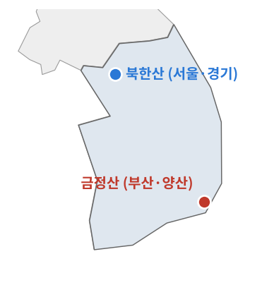

> 현재 연구 배경, 연구 질문, 연구 목적까지 작성하였습니다. 재료·방법·결과·토의·결론은 분석 진행에 따라 순차적으로 작성합니다. 저장소의 `01_공통코드`~`03_분석결과` 폴더에 들어 있는 예제 코드·그림·수치는 교수님 템플릿의 합성자료이며, 7조의 실제 분석 결과가 아닙니다.

### 초록
작성 예정. 연구목적·자료·방법·주요 결과·해석을 분석 완료 후 요약합니다.

**주제어:** 조기낙엽, Sentinel-2, NDVI, 북한산, 금정산, 기온·강수

## 1. 연구 배경 {#background}
2026년 10월, 북한산 저지대 일부에서 단풍이 들기 전에 잎이 갈색으로 말라붙고 일찍 떨어지는 모습이 보도되었다. 보도는 여름철 폭염과 9월 강수 감소에 따른 수분 스트레스를 가능한 배경으로 제시하면서도, 북한산 전체에서 동일한 현상이 나타난 것은 아니라고 설명하였다(김민경, 2026). 이는 일부 지점에서 관찰된 변화가 산림의 어느 범위까지 나타났는지, 정상적인 계절 변화와 어떻게 다른지 살펴볼 필요성을 제기한다. 다만 이 보도만으로 북한산 전체의 조기낙엽 발생 규모나 원인을 판단할 수는 없다.

*그림 1. YTN 「북한산 단풍 절정인데...말라붙은 잎에 '조기 낙엽'까지」(2026.10.30, 기사 제목 부분 캡처)*

조기낙엽에 주목해야 하는 이유는 단풍 경관이 달라졌다는 데만 있지 않다. 특정 조건에서 나타나는 이른 잎의 노화와 낙엽은 이후 수목 상태를 주의 깊게 살펴볼 단서가 될 수 있다. Frei et al.(2022)은 2018년 가뭄 당시 스위스 북부에서 잎이 일찍 노화한 유럽너도밤나무를 2021년까지 추적하였다. 그 결과 이 나무들은 정상 시기에 노화한 나무보다 이후 수관의 가지 고사와 나무 전체의 고사 비율이 높았고 회복도 느렸다. Descals et al.(2023)의 유럽 낙엽수림 연구에서도 이른 낙엽이 나타난 지역은 이후 연도의 여름철 평균 식생지수가 감소하는 경향을 보였다. 이러한 결과를 국내 산림에 그대로 적용할 수는 없다. 그러나 이른 식생 변화를 일시적인 경관 변화로만 취급하지 않고, 이후 상태를 확인할 대상으로 기록할 필요성을 뒷받침한다.

나아가 이러한 산림 식생의 이른 쇠퇴는 생태적 차원을 넘어 경제적 관리 비용과 자원 가치의 문제로도 이어진다. 국립산림과학원(2023)의 2020년 기준 평가에 따르면 우리나라 산림의 공익적 가치는 연간 259조 원에 달하며, 이 중 온실가스 흡수·저장 기능은 97.6조 원이다. 따라서 북한산이나 금정산처럼 대도시와 인접해 이용객이 많은 산림에서 잎이 일찍 마르고 떨어지면, 단풍 경관의 질 저하는 물론 탄소 흡수 등 산림이 제공하는 생태계 서비스의 경제적 가치가 감소할 수 있다. 또한 수목 쇠약이 누적되어 고사나 병해충 피해로 확산될 경우 막대한 사후 대응 비용이 발생하는데, 실제로 산림청(2026)은 2026년 한 해 소나무재선충병 방제에만 약 2,000억 원의 국비를 투입할 계획이다. 이러한 점에 비추어 볼 때, 피해가 광범위하게 진행된 이후에 복구 비용을 투입하기보다 이상 징후가 나타난 구역을 조기에 파악하여 한정된 산림 관리 예산과 인력을 우선 투입할 대상을 선별하는 작업은 경제적·관리적 측면에서 실용적인 의의를 가진다.

이때 필요한 정보는 현상의 존재 여부뿐 아니라 분포와 범위, 나타나기 시작한 시기이다. 변화가 관찰된 위치를 기록하면 이후 현장 확인과 재관찰의 대상을 정하는 데 참고할 수 있다. 면적과 시기를 함께 파악하면 변화가 일부 구역에 국한되었는지, 여러 구역에서 비슷한 시기에 나타났는지 구분할 수 있다. 따라서 이러한 정보를 확보하는 일은 산림 피해를 곧바로 판정하기 위한 것이 아니라, 추가적인 상태 확인이 필요한 구역을 살펴보기 위한 기초자료를 마련한다는 의미가 있다. 북한산 보도는 현장 모습을 보여 주지만, 보도만으로는 분석 대상 산림 전체의 분포와 면적, 변화의 시작 시기를 파악하기 어렵다.

이러한 정보의 부족을 보완하는 데 반복적으로 촬영된 위성영상을 활용할 수 있다. Descals et al.(2023)은 이른 낙엽이 작은 산림 구역에서 나타나고 정상적인 계절 변화와 구별할 수 있는 기간도 짧아, 발생 범위와 반복 양상을 파악하기 어렵다고 설명하였다. 이들은 Sentinel-2 자료를 이용하여 2017~2021년 유럽 산림의 이른 낙엽 분포와 시기를 관측하였다. Brun et al.(2020)도 Sentinel-2 식생지수 시계열과 육안으로 분류한 관측자료를 결합해 2018년 중부 유럽 산림의 이른 잎 마름과 낙엽 분포를 분석하였다. 이러한 사례는 위성영상이 현장 관찰을 대신해 낙엽을 확정하는 수단이라기보다, 개별 관찰 지점을 넘어 공간적 범위와 시간적 변화를 살펴보는 자료가 될 수 있음을 보여 준다. 특히 반복 촬영된 영상은 이미 지나간 시기의 변화도 같은 기준으로 다시 살펴볼 수 있게 해 준다.

북한산에서 제기된 문제를 다른 지역과 비교해 살펴보는 것도 중요하다. 특정 지역에 관한 보도가 있다는 사실만으로 그 현상이 해당 지역에만 나타났다고 볼 수 없다. 반대로 다른 지역의 상태를 확인하지 않고 동일한 변화가 있었을 것이라고 가정해서도 안 된다. 부산 금정산 범어사계곡은 개서어나무 등 낙엽활엽수가 우점하는 산림 군락이 분포하고, 그 보전관리 필요성이 선행연구에서 제시된 지역이다(김정호 외, 2011). 따라서 북한산과 함께 계절적 식생 변화를 살펴볼 대상으로 검토할 수 있다. 다만 이 선행연구는 범어사 일대의 2026년 조기낙엽 발생을 입증하는 자료는 아니다.

*그림 2. 연구지역 위치 (북한산, 금정산)*

두 지역의 비교에서 중요한 것은 어느 산의 식생지수가 더 낮은지를 단순히 가리는 일이 아니다. 위도와 고도, 수종 구성 등이 다른 만큼, 각 지역의 기존 계절 변화에 비추어 2026년에 평소보다 이른 식생 저하가 나타났는지 살펴볼 필요가 있다. 또한 낙엽 시기와 식생지수는 해마다 어느 정도 달라지므로, 2026년의 변화가 각 지역에서 예년에도 나타나던 변동 범위를 넘어서는지를 함께 확인해야 한다. 또한 고온과 강수 부족이 가능한 배경으로 제기되었더라도, 실제 관측된 변화와 기상조건이 어떤 관련성을 보이는지는 별도로 확인해야 한다. 유럽의 선행연구에서도 이른 잎 마름과 낙엽은 고온과 강수 부족이 앞서 나타난 지역과 시기에 함께 관측되었으므로(Brun et al., 2020; Descals et al., 2023), 두 지역의 기온·강수 조건을 의심 구역의 출현 시기와 대조하는 것은 검토할 만한 출발점이 된다. 위성에서 관측되는 식생지수 감소는 실제 낙엽과 동일하지 않으며, 그 자체로 원인을 확정할 수도 없다. 이러한 구분을 전제로 북한산과 범어사 일대의 변화를 기록하고 비교하는 것은, 보도된 현상의 공간적 범위를 보완하고 이후 현장 확인과 지속적인 산림 상태 관찰에 참고할 기초정보를 마련하는 데 의미가 있다.

## 2. 연구 질문 {#question}

연구 배경에서 제기한 문제를 다음 세 질문으로 구체화하였다. 일상적 질문은 연구의 출발점이 되는 의문을 표현하고, 학술적 연구 질문은 분석 대상과 비교 기준을 명시한다. 연구 질문 1–3은 다음 절의 세부목적 1–3에 각각 대응한다.

### 2.1 연구 질문 1

> **일상적 질문:** “북한산에서 보도된 조기낙엽이 위성영상에서도 보일까? 그렇다면 부산 금정산은 어땠을까? 나타났다면 어디에, 얼마나, 언제부터였을까?”

**학술적 연구 질문.** 각 대상지의 2020~2025년 동일 시기 식생지수 변화를 기준으로 할 때, 2026년 북한산과 금정산(범어사 일대) 분석구역의 낙엽활엽수림에서 조기낙엽 의심 구역은 어디에 분포하며, 유효 분석면적 대비 어느 정도의 비율을 차지하고, 언제 처음 탐지되는가?

### 2.2 연구 질문 2

> **일상적 질문:** “올해 잎이 일찍 진 게 정말 평소와 다른 걸까, 아니면 해마다 이 정도는 있는 일일까? 두 산 중 어디가 더 평소와 달랐을까?”

**학술적 연구 질문.** 동일한 탐지 기준을 2020~2025년 각 연도에 적용하여 얻은 의심 구역 면적 비율의 범위와 비교할 때, 2026년의 면적 비율은 그 범위를 벗어나는가? 이러한 이례성의 정도와 최초 탐지 시기는 두 대상지 사이에서 어떻게 다른가?

### 2.3 연구 질문 3

> **일상적 질문:** “잎이 일찍 마른 곳이 더 많았던 산은 그만큼 더 덥고 비가 적었을까?”

**학술적 연구 질문.** 의심 구역이 처음 탐지되기 이전 30일과 해당 월의 평균기온·누적강수량은 각 대상지의 장기 기준(1991~2020년)과 비교하여 어떠한 편차를 보이며, 이 편차의 지역 간 차이는 연구 질문 2에서 확인한 이례성과 최초 탐지 시기의 차이와 같은 방향으로 나타나는가?

## 3. 연구 목적 {#objectives}

### 3.1 전체 연구목적

**본 연구는 Sentinel-2 위성영상을 이용하여 2026년 북한산과 금정산(범어사 일대) 낙엽활엽수림에서 조기낙엽 의심 구역의 분포·면적 비율·최초 탐지 시기를 정량화하고, 각 지역의 과거 연도 변동 범위에 비추어 그 이례성을 비교하며, 기온·강수 편차와의 시기적 대응을 검토하는 것을 목적으로 한다.** 이를 통해 이후 현장 확인과 지속적인 관찰이 필요한 구역의 후보를 제시할 기초자료를 마련하고자 한다.

본 연구에서 조기낙엽 의심 구역은 각 지역의 과거 동일 시기 변화와 비교하여 평소보다 이른 식생지수 감소가 나타나고, 5장에서 제시하는 탐지 기준을 충족하는 구역을 의미한다. 위성영상의 식생지수 감소만으로 실제 낙엽 발생이나 원인을 확정하지 않는다. 분석의 해석 범위는 선정한 두 분석구역과 2026년 7~11월(11월은 13일까지 관측)로 한정한다.

세부목적은 순차적으로 구성하였다. 먼저 두 대상지에서 의심 구역이 어디에, 얼마나, 언제 나타났는지 파악한다(세부목적 1). 다음으로 그 결과가 해마다 나타나는 변동 범위를 넘어서는지 평가하여, 2026년의 변화가 실제로 평소와 달랐는지와 두 지역 중 어디에서 더 두드러졌는지를 판단한다(세부목적 2). 마지막으로 그 차이가 같은 시기의 기온·강수 편차와 함께 나타났는지 검토한다(세부목적 3). 세 목적은 각각 **의심 구역의 탐지와 특성 파악 → 과거 변동 대비 이례성 평가와 지역 비교 → 기상 편차와의 시기적 대응 검토**에 대응한다.

### 3.2 세부목적 1 · 두 대상지 조기낙엽 의심 구역의 분포·면적 비율·최초 탐지 시기 정량화

**연구 질문 1의 목적화.** 각 대상지의 2020~2025년 동일 시기를 기준으로 2026년 조기낙엽 의심 구역을 탐지하고, 그 공간적 분포와 유효 분석면적 대비 면적 비율, 최초 탐지 시기를 대상지별로 정량화한다.

**필요성 및 평가 지표.** 북한산의 현장 보도는 일부 저지대의 모습만 보여 주며, 금정산에 대해서는 비교할 관찰 기록을 찾지 못하였다. 따라서 두 분석구역 전체에서 의심 구역의 위치와 규모를 같은 방식으로 먼저 파악해야 이후의 비교가 가능하다. 평가 지표는 의심 구역 면적(ha)과 유효 분석면적 대비 비율(%), 의심 구역 분포도, 최초 탐지 월로 설정한다. 구름 등으로 관측되지 않은 구역은 의심 현상이 없는 구역과 구분하여 유효 분석면적에서 제외한다.

### 3.3 세부목적 2 · 과거 연도 변동 범위 대비 2026년의 이례성 평가와 대상지 간 비교

**연구 질문 2의 목적화.** 세부목적 1과 동일한 탐지 기준을 2020~2025년 각 연도에 적용하여 연도별 의심 구역 면적 비율의 범위를 구하고, 2026년 값이 그 범위를 벗어나는 정도를 대상지별로 평가한 뒤 두 대상지 사이에서 비교한다.

**필요성 및 평가 지표.** 식생지수의 계절 변화는 해마다 어느 정도 달라지므로, 2026년에 의심 구역이 탐지되었다는 사실만으로 평소와 다른 변화라고 판단할 수 없다. 또한 두 대상지는 분석면적과 정상적인 계절 변화가 달라, 절대면적이나 식생지수 값을 직접 비교하기 어렵다. 따라서 각 지역의 과거 변동 범위에 대한 상대적 위치를 공통 지표로 사용한다. 평가 지표는 2020~2025년 연도별 의심 구역 면적 비율의 최솟값~최댓값 대비 2026년 값의 위치, 같은 기준에서 반대 방향(평소보다 식생지수가 높은) 변화가 나타난 면적과의 비교, 두 대상지의 최초 탐지 월 차이로 설정한다. 2026년 값이 과거 범위 안에 있는 경우에도 그대로 결과로 보고한다.

### 3.4 세부목적 3 · 기온·강수 편차와 의심 구역 발생 양상의 시기적 대응 검토

**연구 질문 3의 목적화.** 각 대상지에서 의심 구역이 처음 탐지되기 이전 30일과 해당 월의 평균기온·누적강수량을 장기 기준(1991~2020년)과 비교하여 편차를 산출하고, 그 지역 간 차이가 세부목적 2에서 확인한 이례성 및 최초 탐지 시기의 차이와 같은 방향인지 검토한다.

**필요성 및 평가 지표.** 보도와 선행연구는 고온과 강수 부족을 가능한 배경으로 제시하였지만, 두 대상지에서 실제로 그러한 조건이 의심 구역 출현과 같은 시기에 나타났는지는 확인되지 않았다. 이를 확인하면 후속 현장조사에서 검토할 환경 스트레스 요인을 좁힐 수 있다. 평가 지표는 탐지 이전 30일 및 해당 월의 평균기온 편차(℃)와 누적강수량의 장기 기준 대비 비율(%), 그리고 이 편차의 지역 간 차이와 세부목적 2 결과의 방향 일치 여부로 설정한다. 대상지가 두 곳뿐이고 수종·고도·사면·병해충 등 다른 요인을 배제할 수 없으므로, 결과는 탐색적인 시기적 대응으로 해석하며 직접적인 원인이나 장기 기후변화의 영향으로 단정하지 않는다.

## 4. 재료 {#materials}
선정 예정. 대상 지역·기간·자료 출처·GEE 자료 ID·해상도·밴드·변수와 단위를 기록합니다.

## 5. 방법 {#method}
작성 예정. 전처리·품질 관리·표본 추출·세부목적별 분석 방법과 실행 순서를 기록합니다.

## 6. 결과 {#results}
분석 예정. 현재 7조의 실제 분석 결과는 없습니다. 분석 후 목적별 지도·그래프·표와 핵심 수치를 제시합니다.

## 7. 토의 {#discussion}
분석 후 작성 예정. 결과의 의미, 다른 가능한 설명, 선행연구와의 관계 및 한계를 논의합니다.

## 8. 결론 {#conclusion}
분석 후 작성 예정. 연구 질문과 각 세부목적에 대한 답을 실제 결과에 근거하여 정리합니다.

---

### 부록 · 재현성 및 연구 기여 {#reproduce}
- 실제 분석 실행일: 미실행
- 조장: CHOI SEONWOO (@woo0754-hash)
- 조원: Kim dae yun (@KDY1013), 김지희 (@jhee5630), Bae sion (@sionking-11), LIM DONGKYU (@gyu3802-coder)
- 역할 분담 및 기여: 협의 후 작성 예정. 참여 평가는 현재 모두 미평가입니다.
- 분석 노트북: 저장소의 `02_개인분석/`에 추가할 예정입니다.
- 참고문헌:
  - 김민경 (2026.10.30). 북한산 단풍 절정인데...말라붙은 잎에 '조기 낙엽'까지. YTN. https://www.ytn.co.kr/_ln/0108_202610301238088261
  - 김정호, 최송현, 최인태, 양순자, 이상철 (2011). 부산 금정산 범어사계곡 낙엽활엽수림의 식생구조. 한국환경생태학회지, 25(4), 581–589. https://koreascience.kr/article/JAKO201134036351113.page
  - 국립산림과학원 (2023.03.29). 2020년 기준 산림공익기능 평가 결과 (보도). https://www.metroseoul.co.kr/article/20230329500012
  - 산림청 (2026.11.11). 산림청, 소나무재선충병 확산 차단 위해 국비 추가 투입 (보도자료). https://m.korea.kr/briefing/pressReleaseView.do?newsId=156788710
  - Brun, P., Psomas, A., Ginzler, C., Thuiller, W., Zappa, M., & Zimmermann, N. E. (2020). Large-scale early-wilting response of Central European forests to the 2018 extreme drought. *Global Change Biology*, 26(12), 7021–7035. https://doi.org/10.1111/gcb.15360
  - Descals, A., Verger, A., Yin, G., Filella, I., & Peñuelas, J. (2023). Widespread drought-induced leaf shedding and legacy effects on productivity in European deciduous forests. *Remote Sensing in Ecology and Conservation*, 9(1), 76–89. https://doi.org/10.1002/rse2.296
  - Frei, E. R., Gossner, M. M., Vitasse, Y., Queloz, V., Dubach, V., Gessler, A., Ginzler, C., Hagedorn, F., Meusburger, K., Moor, M., Samblás Vives, E., Rigling, A., Uitentuis, I., von Arx, G., Wohlgemuth, T., & Schuldt, B. (2022). European beech dieback after premature leaf senescence during the 2018 drought in northern Switzerland. *Plant Biology*, 24(7), 1132–1145. https://doi.org/10.1111/plb.13467

[7조 GitHub 저장소](https://github.com/woo0754-hash/surveying2-team-7) · [수업 게시판](https://wonk19.github.io/class2026_02_surveying2/board.html) · [교수님 원본 템플릿](https://github.com/wonk19/class2026_02_surveying2)

[섹션별 작성 지침]({{ site.github.repository_url }}/blob/main/05_보고서양식/섹션별_작성지침.md)
