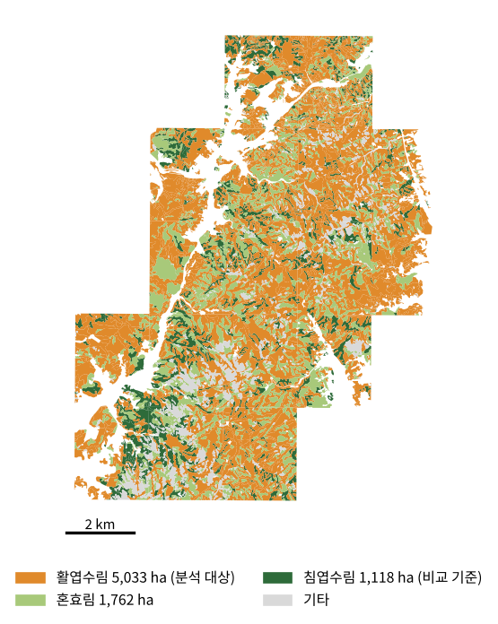
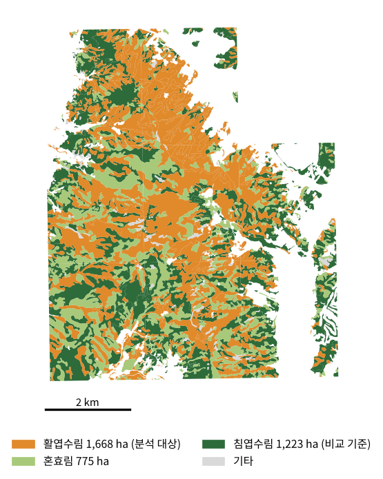
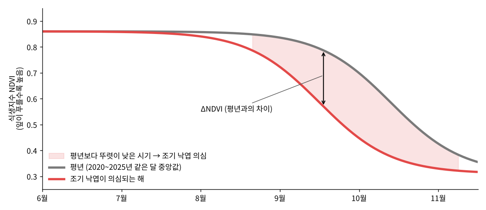

> 현재는 보고서 틀을 준비한 단계입니다. 연구 주제와 세부목적은 조원 논의 및 교수님 확인 후 작성합니다. 저장소에 포함된 예제 코드·그림·수치는 교수님 템플릿의 합성자료이며, 7조의 실제 분석 결과가 아닙니다.

### 초록
작성 예정. 연구목적·자료·방법·주요 결과·해석을 분석 완료 후 요약합니다.

**주제어:** 선정 예정

## 1. 연구 배경 {#background}
최근 국내에서는 정상적인 단풍 시기보다 이르게 잎이 마르거나 떨어지는 조기낙엽 현상이 산림의 환경적 문제로 주목받고 있다. 2026년 10월 부산일보는 폭염과 가뭄, 불규칙한 강수 등 기상조건이 수목 생육에 영향을 미칠 가능성을 제기하였으며, YTN은 북한산 일부 저지대에서 단풍이 충분히 들기 전에 잎이 갈색으로 마르거나 떨어지는 현상을 보도하였다.

*그림 1. 부산일보 칼럼 「[밀물썰물] '조기 낙엽'이 던진 숙제」(2026.10.26, 기사 제목 부분 캡처)*

*그림 2. YTN 「북한산 단풍 절정인데...말라붙은 잎에 '조기 낙엽'까지」(2026.10.30, 기사 제목 부분 캡처)*

특히 여름철 고온과 가을철 강수 부족에 따른 수분 스트레스가 이러한 현상에 영향을 미쳤을 가능성이 제시되었다.

**표 1.** 2026년 여름·가을 날씨 (기상청 발표)

| 항목 | 2026년 | 의미 |
|---|---|---|
| 여름(6~8월) 전국 평균기온 | **25.4 ℃ (평년 +1.7 ℃)** | 평년보다 뚜렷이 더운 여름 |
| 여름 전국 강수량 | **558.6 mm (평년의 76.1%)** | 1973년 이후 적은 10위 안 |
| 9월 전국 강수량 | **평년의 17%** | 9월 기준 역대 두 번째로 적음 |

<small>자료: 기상청 「2026년 여름철 기후특성」·「2026년 9월 기후특성」(파이낸셜뉴스 2026.09.03, 헤럴드경제 2026.10.02 보도)</small>

이러한 보도를 계기로 실제 조기낙엽 현상이 관찰된 북한산뿐만 아니라, 우리 지역인 부산의 산림에서도 유사한 현상이 나타나는지에 대한 의문을 갖게 되었다. 이에 북한산과 부산의 특정 산림을 대상으로 조기낙엽 의심 현상의 발생 여부와 양상을 살펴보고자 한다.

낙엽활엽수는 일반적으로 가을철 기온과 일조시간의 변화에 따라 잎의 노화와 낙엽이 진행되지만, 고온이나 수분 부족 등의 환경적 스트레스는 잎의 노화를 앞당길 수 있다. Zhang et al.(2025)은 「Declining precipitation frequency may drive earlier leaf senescence by intensifying drought stress and enhancing drought acclimation」에서 강수 빈도 감소가 수분 스트레스를 심화시켜 잎의 노화를 앞당길 가능성을 제시하였다. 조기낙엽이 반복될 경우 광합성 기간 단축으로 수목의 생육과 산림의 탄소 흡수 기능에 영향을 줄 수 있으며, 산림 경관과 생태적 기능에도 변화가 나타날 가능성이 있다. 따라서 조기낙엽 의심 현상의 발생 특성과 관련 환경요인을 파악하는 것은 산림 건강성 관리 측면에서 의미가 있다.

**표 2.** 알려진 것과 부족한 것

| 알려진 것 | 근거 | 부족한 것 → 이 연구가 확인할 것 |
|---|---|---|
| 강수 빈도가 줄면 잎 노화가 빨라질 수 있다 | Zhang et al. (2025) | 2026년 우리나라 산에서도 그런 신호가 보였는지 |
| 북한산 저지대에서 조기 낙엽이 관찰됐다 | YTN (2026) | 산 전체에서 얼마나 넓게, 언제부터 나타났는지 |
| 금정산 범어사계곡에 낙엽활엽수 군락이 있다 | 김정호 외 (2011) | 같은 해 금정산에서도 비슷한 현상이 나타났는지 |

본 연구는 조기낙엽 현상이 보도된 북한산과, 우리 지역인 부산 금정산을 연구지역으로 선정하였다.

*그림 3. 연구지역 위치*

관련 보도에 따르면 북한산은 2026년 조기낙엽 의심 현상이 현장에서 관찰된 지역으로, 위성영상에서도 평소보다 이른 식생 감소가 확인되는지 검토하고자 한다.

*그림 4. 북한산 산림유형 (산림청 1:5,000 임상도)*

금정산은 부산의 낙엽활엽수림을 조사하기 위한 대상지로, 특히 범어사계곡 일대는 김정호 외(2011)의 「부산 금정산 범어사계곡 낙엽활엽수림의 식생구조」에서 개서어나무와 졸참나무 등이 우점하는 낙엽활엽수 군락이 확인된 지역이다.

*그림 5. 금정산 산림유형 (산림청 1:5,000 임상도)*

또한 산림청 임상도를 활용하면 두 지역의 활엽수림을 구분하고, 침엽수림과 혼효림을 제외한 분석구역을 설정할 수 있다. 이를 바탕으로 북한산에서 보도된 조기낙엽 의심 현상이 부산 금정산에서도 관측되는지 확인하고, 각 지역에서 나타나는 식생 변화의 특성을 비교하고자 한다.

이에 본 연구는 Sentinel-2 위성영상을 활용하여 2020~2025년 같은 달 식생지수의 중앙값(평년)을 기준으로 2026년 북한산과 금정산의 식생 변화를 분석하고자 한다.

*그림 6. 위성으로 보는 "조기 낙엽 의심"의 개념 (설명용 모식도, 실제 자료 아님)*

먼저 각 지역에서 평소보다 이른 식생지수 감소가 나타나는 조기낙엽 의심 구역을 탐지하고, 공간적 분포와 면적 비율 및 최초 탐지 시기를 파악한다. 이후 두 지역의 조기낙엽 의심 구역 발생 양상을 비교하고, 고온과 강수 부족 등 기상 스트레스 요인이 함께 나타나는지 검토한다. 다만 위성영상의 식생지수 감소만으로 실제 낙엽 발생이나 직접적인 원인을 확정할 수는 없으므로, 두 지역에서 관측되는 조기 식생 감소의 공통점과 차이점을 파악하고, 이러한 현상에 기온과 강수량이 관련되어 있는지를 탐색하는 데 연구의 목적을 둔다.

## 2. 연구 질문 {#question}
작성 예정. 분석 대상·지역·기간·비교 조건을 정한 뒤 분석으로 답할 수 있는 질문을 작성합니다.

## 3. 연구 목적 {#objectives}
### 3.1 전체 연구목적
선정 예정.

### 3.2 세부목적 1
선정 예정.

### 3.3 세부목적 2
선정 예정.

### 3.4 세부목적 3
선정 예정.

## 4. 재료 {#materials}
선정 예정. 대상 지역·기간·자료 출처·GEE 자료 ID·해상도·밴드·변수와 단위를 기록합니다.

## 5. 방법 {#method}
작성 예정. 전처리·품질 관리·표본 추출·세부목적별 분석 방법과 실행 순서를 기록합니다.

## 6. 결과 {#results}
분석 예정. 현재 7조의 실제 분석 결과는 없습니다. 분석 후 목적별 지도·그래프·표와 핵심 수치를 제시합니다.

## 7. 토의 {#discussion}
분석 후 작성 예정. 결과의 의미, 다른 가능한 설명, 선행연구와의 관계 및 한계를 논의합니다.

## 8. 결론 {#conclusion}
분석 후 작성 예정. 연구 질문과 각 세부목적에 대한 답을 실제 결과에 근거하여 정리합니다.

---

### 부록 · 재현성 및 연구 기여 {#reproduce}
- 실제 분석 실행일: 미실행
- 조장: CHOI SEONWOO (@woo0754-hash)
- 조원: Kim dae yun (@KDY1013), 김지희 (@jhee5630), Bae sion (@sionking-11), LIM DONGKYU (@gyu3802-coder)
- 역할 분담 및 기여: 협의 후 작성 예정. 참여 평가는 현재 모두 미평가입니다.
- 분석 노트북: 저장소의 `02_개인분석/`에 추가할 예정입니다.
- 참고문헌:
  - 김정호, 최송현, 최인태, 양순자, 이상철 (2011). 부산 금정산 범어사계곡 낙엽활엽수림의 식생구조. 한국환경생태학회지, 25(4), 581–589.
  - Zhang, X., Wang, X., Zohner, C. M., Peñuelas, J., et al. (2025). Declining precipitation frequency may drive earlier leaf senescence by intensifying drought stress and enhancing drought acclimation. *Nature Communications*, 16, 910. https://doi.org/10.1038/s41467-025-56159-4
  - YTN (2026.10.30). 북한산 단풍 절정인데...말라붙은 잎에 '조기 낙엽'까지.
  - 천영철 (2026.10.26). [밀물썰물] '조기 낙엽'이 던진 숙제. 부산일보. https://www.busan.com/view/busan/view.php?code=2026102618013921999

[7조 GitHub 저장소](https://github.com/woo0754-hash/surveying2-team-7) · [수업 게시판](https://wonk19.github.io/class2026_02_surveying2/board.html) · [교수님 원본 템플릿](https://github.com/wonk19/class2026_02_surveying2)

[섹션별 작성 지침]({{ site.github.repository_url }}/blob/main/05_보고서양식/섹션별_작성지침.md)
